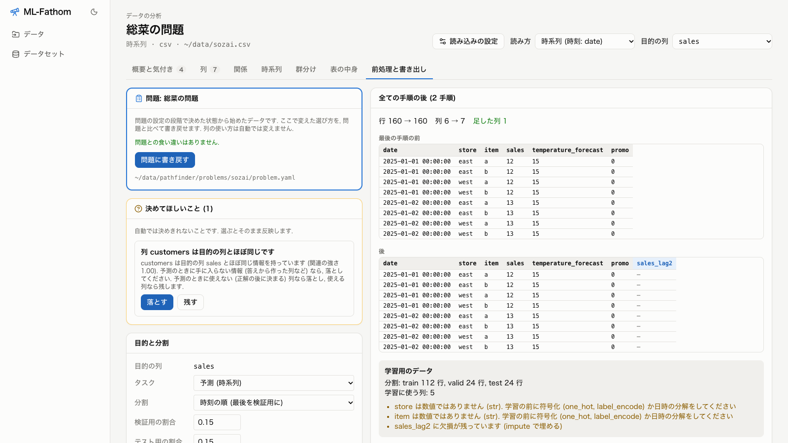
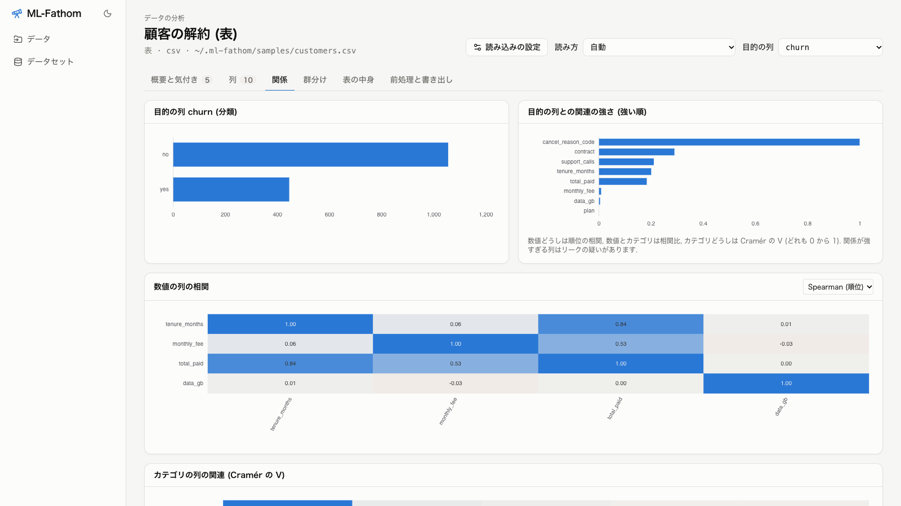
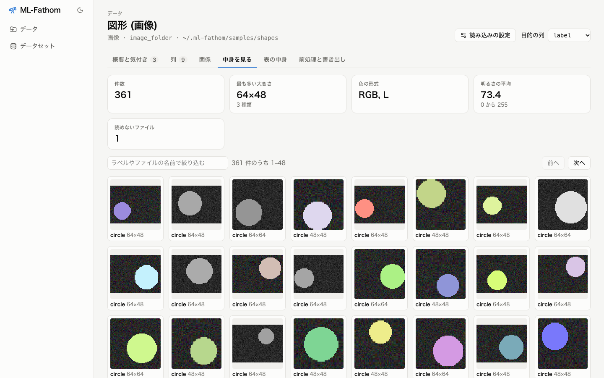
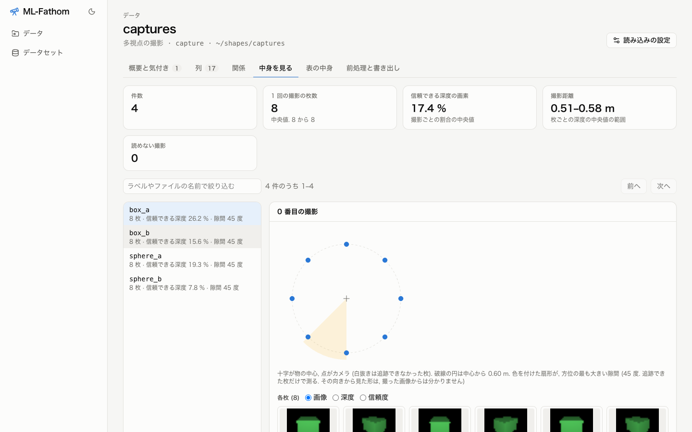
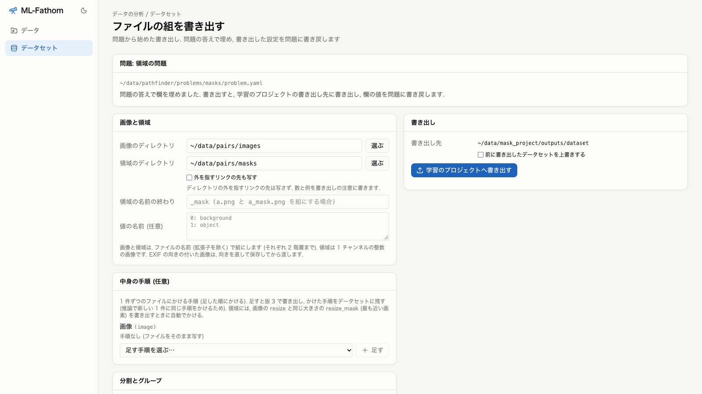

# ML-Fathom

機械学習に使うデータを, 画面の上で分析 (EDA) し, 前処理して学習用に書き出すローカルの Web アプリ.

「機械学習を全て GUI 上で行う」流れのうち, データの分析の段階を受け持つ. 読み込み, 分析, 前処理, 書き出しは [ML-EDA](https://github.com/victor-von-pooh/ML-EDA) が行い, 書き出したデータセットは [ML-Found](https://github.com/victor-von-pooh/ML-Found) の学習スクリプトがそのまま読める.


<table>
  <tr>
    <td></td>
    <td></td>
  </tr>
  <tr>
    <td></td>
    <td></td>
  </tr>
  <tr>
    <td></td>
    <td></td>
  </tr>
  <tr>
    <td colspan="2" align="center"></td>
  </tr>
</table>

画面の例は「見本のデータを入れる」で登録する見本 (顧客の解約の表, 電力の使用量の時系列, 図形の画像, 物体の点群). 多視点の撮影とファイルの組の書き出しは, ML-EDA の合成の見本 (`write_shape_captures` の撮影, `write_image_masks` の画像と領域).

## できること

- **読み込む**: 表 (csv, tsv, json, jsonl, parquet, xlsx, npy), 時系列, 画像, 文, 点群 (ply, pcd, xyz など), 多視点の撮影 (`transforms.json`), 音声 (wav. flac, mp3, ogg, aiff は soundfile で) を, 形式を判定した候補から選んで登録する. 元のファイルは書き換えない
- **分析する**: 列の型, 分布, 欠損, 関係, 時系列の周期と, 学習の前に確かめた方がよいこと (気付き). 画像は並べて, 点群は 3D で回して, 撮影はカメラの配置と深度を見る. 音声は 1 件ずつ聞いて波形を見る
- **前処理を組み立てる**: 気付きと列の型から手順を作り, 1 段ずつ前と後を確かめる. 自動では決めきれないこと (リークの疑いの列を落とすか, 分割の方法など) は選択肢付きで聞く
- **書き出す**: 1 件 = 1 行のデータセット (ML-EDA の `load_dataset` で読む) と, 画像と領域, 撮影と点群のように入力と正解がファイルの組のデータセット (`load_items` で読む)
- **問題の設定から始める**: ML-Pathfinder で決めた問題の設定 (置き場の一覧から選ぶか `problem.yaml` を選ぶ) から, 目的の列, 分割, 使わない列を決めた状態で始め, ここで変えた選び方を書き戻す. ML-Pathfinder で学習のプロジェクトを書き出してあれば, 「プロジェクトへ書き出す」でプロジェクトが読む場所にそのまま書き出す. 正解が画像の領域か点群の問題の設定は, ファイルの組の書き出しを問題の設定の値で埋めて開き, プロジェクトへ書き出して設定を書き戻す
- **モデルに要るもの**: 書き出した表のデータセットごとに, モデルの入力の形と型と出す値の数を一覧に出す

## 使い方

### 必要なもの

- [uv](https://docs.astral.sh/uv/) (Python は uv が用意する. 3.10 以上)
- Node.js 24 以上と [pnpm](https://pnpm.io/) 11 以上 (`corepack enable` で `package.json` の版が入る)

### 導入と起動

```bash
git clone --recursive https://github.com/victor-von-pooh/ML-Fathom.git
cd ML-Fathom
make setup   # submodule, Python と Node.js の依存
make serve   # 画面をビルドして http://127.0.0.1:8767 で起動 (Ctrl+C で止める)
```

端末に出る `ML-Fathom を開く: http://127.0.0.1:8767/api/auth?token=...` の URL をブラウザで開く (トークンは起動ごとに変わる. 環境変数 `ML_FATHOM_TOKEN` で決められる). ポートは `make serve PORT=8800` のように変えられる. 置き場は `~/.ml-fathom/` (環境変数 `ML_FATHOM_HOME` で変えられる). 問題の設定の一覧は ML-Pathfinder の置き場 `~/.ml-pathfinder/` を読む (ML-Pathfinder と同じ環境変数 `ML_PATHFINDER_HOME` で変えられる).

まず「見本のデータを入れる」を押すと, 表, 時系列, 画像, 文, 点群の見本で全ての画面を試せる. 書き出したデータセットは学習のスクリプトで次のように読む.

```python
from ml_eda import load_dataset
from torch.utils.data import DataLoader, TensorDataset

dataset = load_dataset("~/.ml-fathom/datasets/<名前>")
train_loader = DataLoader(TensorDataset(*dataset.tensors("train")), batch_size=64, shuffle=True)
```

## 文書

- [操作ガイド](docs/GUIDE.md): 画面の順の操作ガイド (見本のデータで試せる「やってみる」付き). 最後の章が「困ったとき」
- [設計](docs/DESIGN.md): 今の設計と決まり (ML-EDA と ML-Quest との約束, 画面, API, 用語, 置き場, 安全)
- [TODO](TODO.md): まだやっていないこと (優先度の順)

## 開発

```bash
make dev-backend    # API (変更を自動で読み直す. 開く URL を出す)
make dev-frontend   # 画面 (別の端末で)
make check          # lint, 型検査, テスト
cd frontend && pnpm e2e   # 画面の通しのテスト
```

| ディレクトリ | 内容 |
| --- | --- |
| `backend/` | API (Python, FastAPI). ML-EDA を呼び, 登録したデータとレシピを保存する |
| `frontend/` | 画面 (TypeScript, React, Vite, ECharts) |
| `ML-EDA/` | submodule (データの分析のライブラリ) |
| `ML-Quest/` | submodule (問題の設定から始めるため) |
| `docs/` | 操作ガイド, 設計, README の画面の例 (`images/`) |

## ライセンス

MIT
