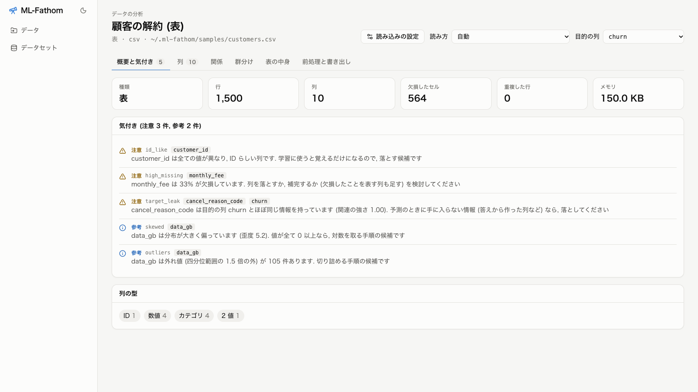
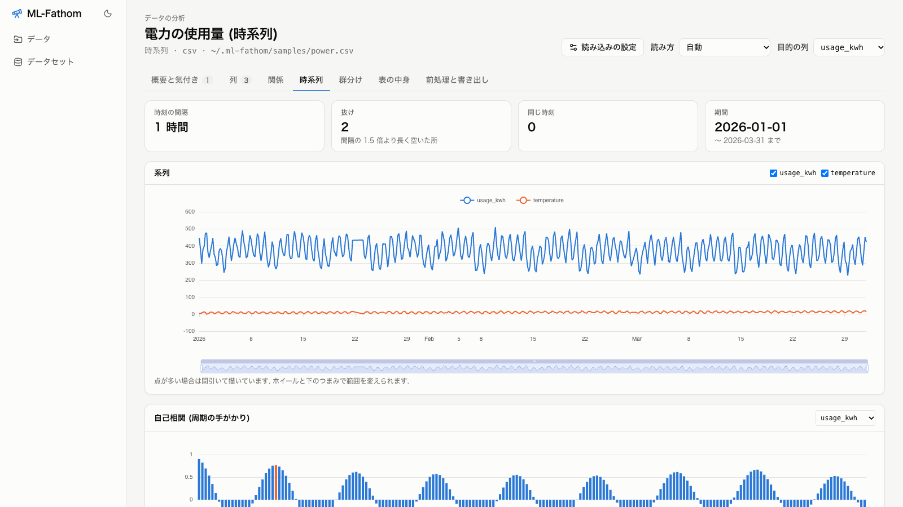
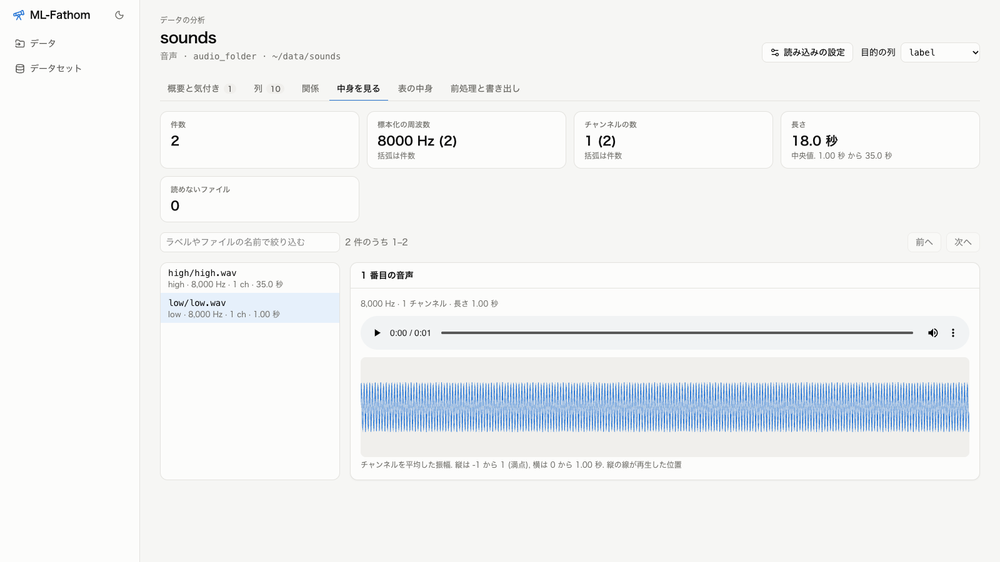
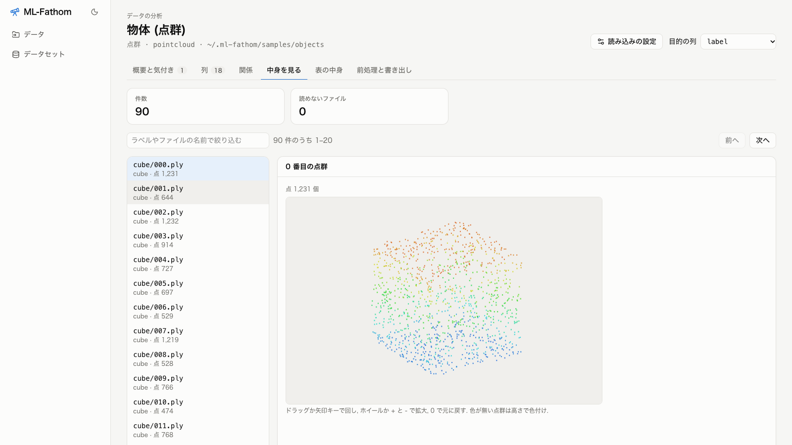

# ML-Fathom

機械学習に使うデータを, 画面の上で分析 (EDA) し, 前処理して学習用に書き出すローカルの Web アプリ.

「機械学習を全て GUI 上で行う」流れのうち, データの分析の段階を受け持つ. 読み込み, 分析, 前処理, 書き出しは [ML-EDA](https://github.com/victor-von-pooh/ML-EDA) が行い, 書き出したデータセットは [ML-Found](https://github.com/victor-von-pooh/ML-Found) の学習スクリプトがそのまま読める.



<table>
  <tr>
    <td></td>
    <td></td>
  </tr>
  <tr>
    <td></td>
    <td></td>
  </tr>
  <tr>
    <td></td>
    <td></td>
  </tr>
  <tr>
    <td colspan="2" align="center"></td>
  </tr>
</table>

画面の例は, 「見本のデータを入れる」で登録する見本 (顧客の解約の表, 電力の使用量の時系列, 図形の画像, レビューの文, 物体の点群) と, 画面の通しのテストの見本 (音声, ML-Pathfinder で保存した問題, 画像と領域の組).

## できること

### データを入れる

- 表 (csv, tsv, json, jsonl, parquet, xlsx, npy), 時系列, 画像, 文, 点群 (ply, pcd, xyz など), 多視点の撮影 (`transforms.json`), 音声 (wav, flac, mp3, ogg, opus, aif, aiff), 強化学習の記録した軌跡 (1 歩が 1 行の csv か parquet と, 説明の json) のファイルかディレクトリを選ぶと, 形式を判定した読み込みの候補が出るので, 選んで登録する. 元のファイルは書き換えない
- 「見本のデータを入れる」を押すと, 表, 時系列, 画像, 文, 点群の見本が入り, 自分のデータが無くても表, 時系列, 画像, 文, 点群の画面を試せる

### 中身を分析する

- **概要と気付き**: 行と列の数, 欠損, 重複と, 学習の前に確かめた方がよいこと (ID らしい列, 欠損の多い列, 目的の列のリークの疑い, 偏りと外れ値など). 気付きの列の名前を押すと, その列の詳細に移る
- **列と関係**: 列ごとの型と分布, 目的の列の分布と, 目的の列との関連の強さ, 数値の列の相関
- **時系列**: 時刻の間隔と抜け, 系列のグラフ, 自己相関から見た周期の候補
- **1 件ずつの中身**: 画像は並べて, 点群は 3D で回して, 撮影はカメラの配置と深度を, 音声は再生と波形で見る. 大きさや周波数のばらつきと読めないファイルの数も出す
- **記録した軌跡**: 強化学習の方策を走らせた記録 (ML-Found の評価の軌跡など) の, エピソードの数と長さ, 報酬の和の分布, 終わり方, 行動の偏り, 観測の要素ごとの統計, 守りの結果と理由, 行動を選んだ確率の列の欠けと範囲の外の数, エピソードごとの一覧. 「分析を書き出す」で要約を JSON で保存する
- **群分け (正解の無い表)**: 1 行が 1 つの対象の表で, 群を作る列と群の数を選ぶと, 学習に通さずに群を作り, 群ごとの行の数, 割合, 安定性と列の特徴 (数の列は平均, 他の列は最も多い値) を全体の行と並べ, 群の安定性 (調整ランド指数. 作り直した群との一致. 問題から始めたデータは問題の数え方で数える) とまとまり (シルエット係数) を出す
- **並べるの反応の表**: 推薦 (並べる) の問題に入れた, 利用者が品物に反応した記録の表を, 問題で答えた列で読み, 反応, 利用者, 品物の数と密度, 品物の人気の偏り (上位の品物の割合, ジニ係数, 多い品物), 利用者ごとと品物ごとの反応の数の分布, 時刻の範囲, 学習で除く行の数を出す. 見せただけの印の列を答えた問題では, 見せただけの記録 (見せたが選ばれなかった品物の行) も学習と同じ決まりで読み, 除く行に数える

### 前処理を組み立てて書き出す

- 目的の列, タスク, 分割 (無作為, 層化, グループ, 時刻の順など) を選び, 「学習できる形にする手順を作る」で気付きと列の型から手順を作る. 手順は足したり消したりでき, 1 段ずつ前と後の表を見て確かめられる
- 自動では決めきれないこと (リークの疑いの列を落とすか残すかなど) は, 選択肢付きで「決めてほしいこと」に出る
- **異常の検知**: 正常の行が多い表 (機械のセンサの値や取引の記録など) は, タスクを「異常の検知」にすると, 正常の行だけを学習用にし, 異常の行を検証用とテスト用に配る. 異常の行にだけ印を付けた表は, 正解の欠けた行を「正常と見なす」にでき, 1 行ごとの番号の「行の id の列」(学習には使わず, 異常らしい行を元の表と突き合わせるために残す) も選べる. 正解の付いた行の数, 異常の行の数と割合を, 手順を組む前に概要と気付きのタブで見る. 分割ごとの正常, 正常と見なした, 異常の行の数も, 書き出す前と書き出した後とデータセットの一覧で見る
- **効果を見積もる**: クーポンを無作為に配った記録のような, 処置の列と結果の列を持つ表は, タスクを「効果を見積もる」にすると, 処置の群と対照の群の行の数と処置の割合, 群ごとの結果の平均と差, 群どうしの釣り合いと気付き (片方の群が少なすぎる, 無作為に配った記録に見えない, 処置の後に決まる列) を出し, 全ての分割に両方の群を置いて書き出す. 分割ごとの群の数と結果の差を, 書き出す前と書き出した後とデータセットの一覧で見る
- **値段を変える判断**: 試しに値段を変えた売れ行きの記録のような, 値段の列 (売ったときの値段) と売れた数の列 (その値段で売れた数) を持つ表は, タスクを「値段を変える判断」にすると, 原価の列 (商品 1 つを仕入れるか作るのにかかる値段) と商品の id の列も選べ, 値段の幅と種類の数, 弾力性の目安 (値段を 1 % 上げたときに売れた数が何 % 変わるか), 商品ごとの試した値段, 値段と他の列の関わりと気付き (値段の種類が少なすぎる, 試した値段が 1 つの商品, 無作為に近く変えた記録に見えない) を出し, 値段の段で層を作って書き出す. 値段の列にかけられる手順は `clip`, `log`, `standardize`, `minmax` だけに絞る. 分割ごとの値段の範囲と売れた数を, 書き出す前と書き出した後とデータセットの一覧で見る
- **時間をまたぐ量の判断**: 商品ごとの日ごとの売れた数の記録のような, 商品の id の列, 日付の列, 売れた数の列を持つ表は, タスクを「時間をまたぐ量の判断」にすると, 在庫の数の列と先の期間の日数 (既定 7 日) も選べ, 日付の範囲, 曜日ごとの売れた数, 商品ごとの記録の日数と抜けの日, 在庫が 0 の日と気付き (記録の短い商品, 記録の無い日, 品切れで抑えられた売れた数) を出し, 1 行を (商品, 発注を決める日), 正解を先の期間の売れた数の合計にして, 発注を決める日の順に分けて書き出す. 過去の売れた数を商品ごとに日付でずらす手順を 1 回で足せる. 分割ごとの発注を決める日の範囲と期間の合計を, 書き出す前と書き出した後とデータセットの一覧で見る
- 「学習用に書き出す」で, 1 件 = 1 行のデータセットにする. 画像と領域, 撮影と点群のように入力と正解がファイルの組になるデータは, 「ファイルの組を書き出す」で書き出す. 群分けの正解の無い表は, 「群分け」のタブの「群分けの表を分析用に書き出す」で, 群を作る列と行を見分ける列だけを分析用の書き出し (ML-EDA の「分析の保存」) として書き出す (学習には使わない)
- データセットの一覧で, 書き出したものごとに分割の件数と, モデルの入力の形と型, 出す値の数を見る

### 他の段階のアプリとつなぐ

- **ML-Pathfinder から受け取る**: 「問題から始める」で, 問題の設定の段階で決めた問題 (保存した一覧から選ぶか `problem.yaml` を選ぶ) を開くと, 入れたデータを登録し, 目的の列, 分割, 使わない列を決めた状態で始まる. ここで変えた選び方は「問題に書き戻す」で戻せる. 作るものが画像か表の問題は, 目的の列の無いレシピで始まる. 異常の検知の問題は, 異常の正解の列と行の id の列を入れた異常の検知のレシピで始まる (異常の検知の問いに答えていない問題と, 同梱の ML-Quest を異常の検知を知らない古い版に替えた場合は「問題を渡せません」と出て始まらない). 今ある記録から効果を見積もる問題は, 結果の列, 処置の列, 結果の種類と行の id の列を入れた効果を見積もるのレシピで始まる (効果の見積もりの問いに答えていない問題と, 同梱の ML-Quest を効果の見積もりを知らない古い版に替えた場合は「問題を渡せません」と出て始まらない). 今ある記録で値段を変えた問題は, 売れた数の列, 値段の列, 原価の列, 商品の id の列と行の id の列を入れた値段を変える判断のレシピで始まる (値段を変える判断の問いに答えていない問題と, 同梱の ML-Quest が値段を変える判断を受けない版の場合は「問題を渡せません」と出て始まらない). 商品ごとの日ごとの売れた数から先の期間の需要を予測する問題は, 日ごとの売れた数の列, 商品の id の列, 日付の列, 在庫の数の列と先の期間の日数を入れた時間をまたぐ量の判断のレシピで始まる (時間をまたぐ量の判断の問いに答えていない問題と, 同梱の ML-Quest が時間をまたぐ量の判断を受けない版の場合は「問題を渡せません」と出て始まらない). 正解が画像の領域か点群の問題は, ファイルの組の書き出しを問題の値で埋めて開く. 並べるの問題は, 入れた反応の表を開く (前処理のレシピは持たない). まとめるの問題は, 入れた表の「群分け」のタブを, 答えた群を作る列, 行を見分ける列と群の数で埋めて開き, そこで変えた選び方も「問題に書き戻す」で戻せる
- **学習のプロジェクトへ渡す**: ML-Pathfinder で学習のプロジェクトを書き出してあれば, 「学習のプロジェクトへ書き出す」で, 学習のプロジェクトが読む場所にデータセットをそのまま書き出す. 並べるの反応の表とまとめるの表は, 前処理せずファイル 1 つのまま写す (分割は学習のプロジェクトが行う)
- **学習とモデルへ渡す**: 書き出したデータセットは [ML-EDA](https://github.com/victor-von-pooh/ML-EDA) の `load_dataset` (ファイルの組と群分けの表は `load_items`) で読める. 版 1 とファイルの組のデータセットは, [ML-Found](https://github.com/victor-von-pooh/ML-Found) の学習スクリプトがそのまま使う. 群分けの表 (版 2) は分析用の書き出しで, 学習のプロジェクトの骨組みが読む形ではないので, まとめるの学習には「学習のプロジェクトへ書き出す」で表のファイルを写す. 一覧に出るモデルの入力の形と出す値の数は, ML-CreateArchitecture でモデルの部品の引数を合わせるときの目安になる

## 使い方

### 必要なもの

- [uv](https://docs.astral.sh/uv/) 0.13.10 以上 (Python は uv が用意する. 3.10 以上)
- Node.js 24 以上と [pnpm](https://pnpm.io/) 11 以上 (`corepack enable` で `package.json` の版が入る)

### 導入と起動

```bash
git clone --recursive https://github.com/victor-von-pooh/ML-Fathom.git
cd ML-Fathom
make setup   # submodule, Python と Node.js の依存
make serve   # 画面をビルドして http://127.0.0.1:8767 で起動 (Ctrl+C で止める)
```

端末に出る `ML-Fathom を開く: http://127.0.0.1:8767/api/auth?token=...` の URL をブラウザで開く (トークンは起動ごとに変わる. 環境変数 `ML_FATHOM_TOKEN` で決められる). ポートは `make serve PORT=8800` のように変えられる. 置き場は `~/.ml-fathom/` (環境変数 `ML_FATHOM_HOME` で変えられる). 問題の一覧は ML-Pathfinder の置き場 `~/.ml-pathfinder/` を読む (ML-Pathfinder と同じ環境変数 `ML_PATHFINDER_HOME` で変えられる).

まず「見本のデータを入れる」を押すと, 表, 時系列, 画像, 文, 点群の見本で画面を試せる. 書き出したデータセットは学習のスクリプトで次のように読む.

```python
from ml_eda import load_dataset
from torch.utils.data import DataLoader, TensorDataset

dataset = load_dataset("~/.ml-fathom/datasets/<名前>")
train_loader = DataLoader(TensorDataset(*dataset.tensors("train")), batch_size=64, shuffle=True)
```

## 文書

- [操作ガイド](docs/GUIDE.md): 画面の順の操作ガイド (見本のデータで試せる「やってみる」付き). 最後の章が「困ったとき」
- [設計](docs/DESIGN.md): 今の設計と決まり (ML-EDA と ML-Quest との約束, 画面, API, 用語, 置き場, 安全)
- [TODO](TODO.md): まだやっていないこと (優先度の順)

## 開発

```bash
make dev-backend    # API (変更を自動で読み直す. 開く URL を出す)
make dev-frontend   # 画面 (別の端末で)
make check          # lint, 型検査, テスト
cd frontend && pnpm e2e   # 画面の通しのテスト
```

README の画面の例は, 画面の通しのテストの見本で起動したアプリを撮って作る (`cd frontend && pnpm build && bash e2e/serve.sh` の後, 別の端末で `cd frontend && node e2e/shots.mts`. 1600x900 の PNG を `docs/images/` に書く).

| ディレクトリ | 内容 |
| --- | --- |
| `backend/` | API (Python, FastAPI). ML-EDA を呼び, 登録したデータとレシピを保存する |
| `frontend/` | 画面 (TypeScript, React, Vite, ECharts) |
| `ML-EDA/` | submodule (データの分析のライブラリ) |
| `ML-Quest/` | submodule (問題から始めるため) |
| `docs/` | 操作ガイド, 設計, README の画面の例 (`images/`) |

## ライセンス

MIT
