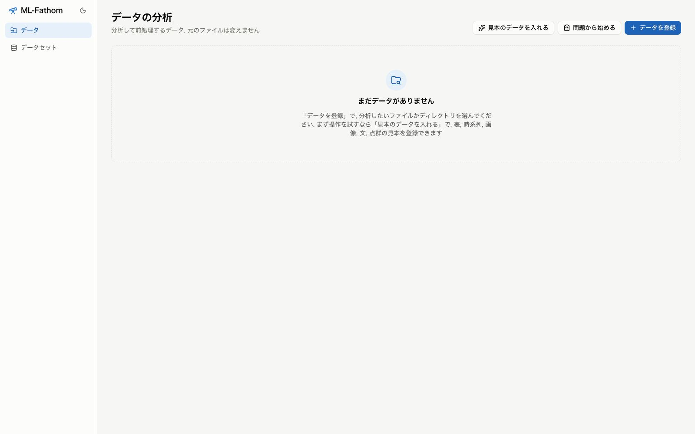
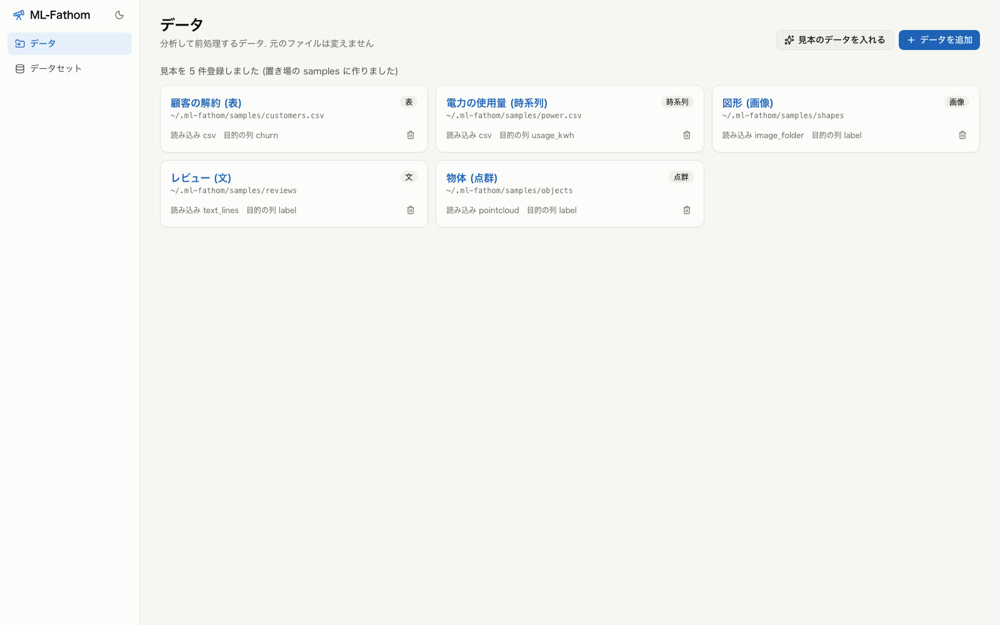
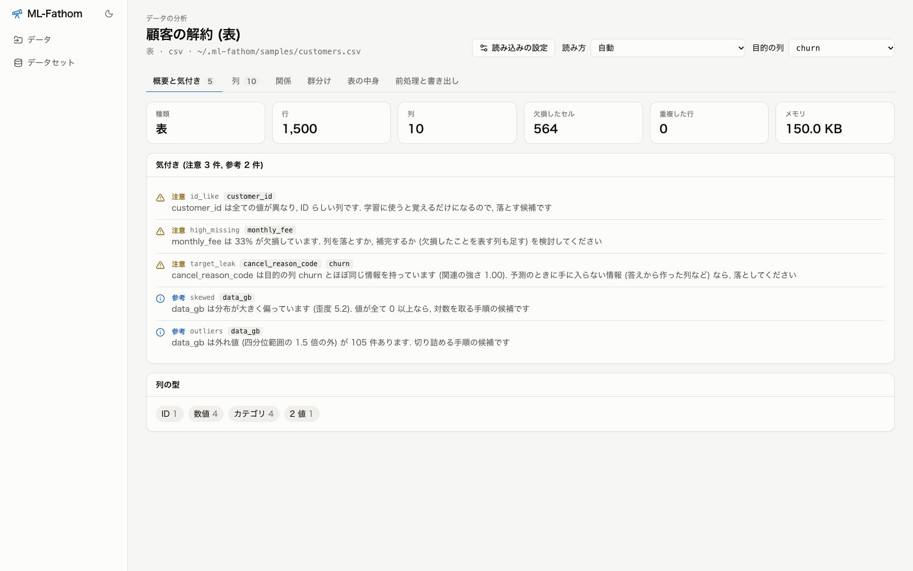
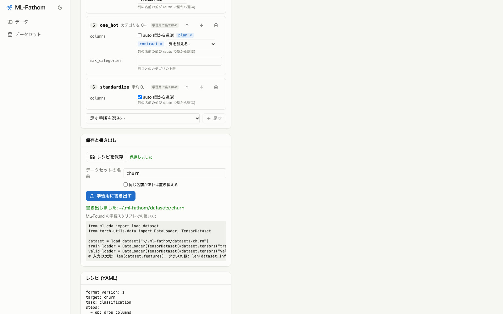
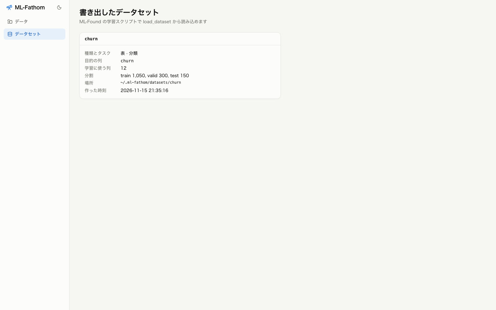
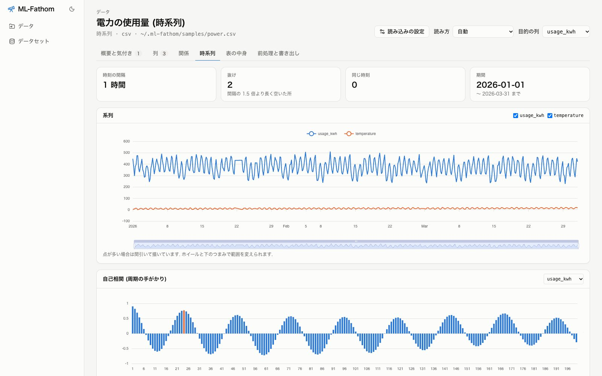
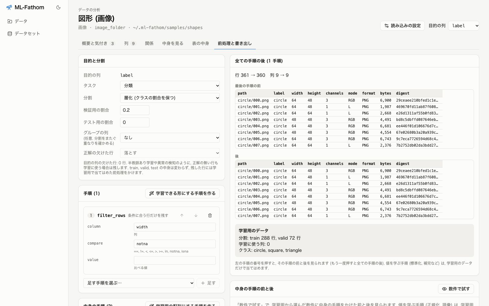
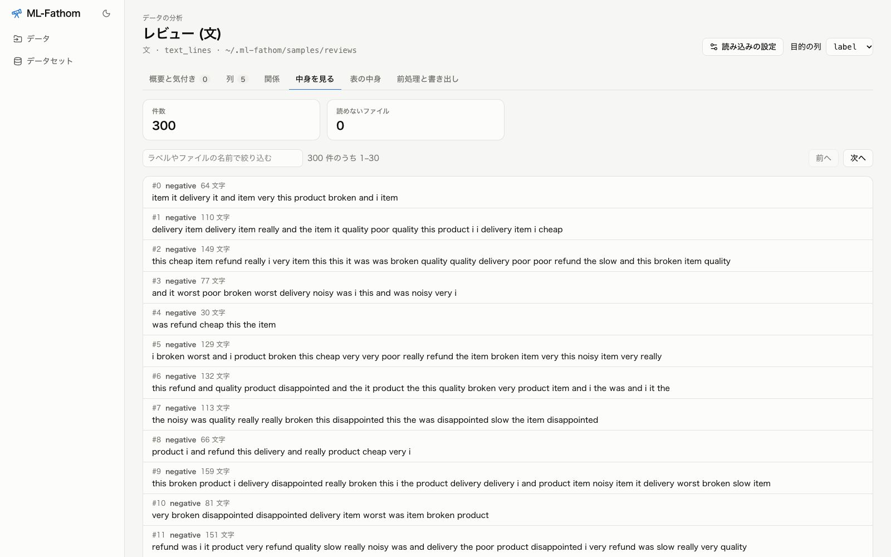
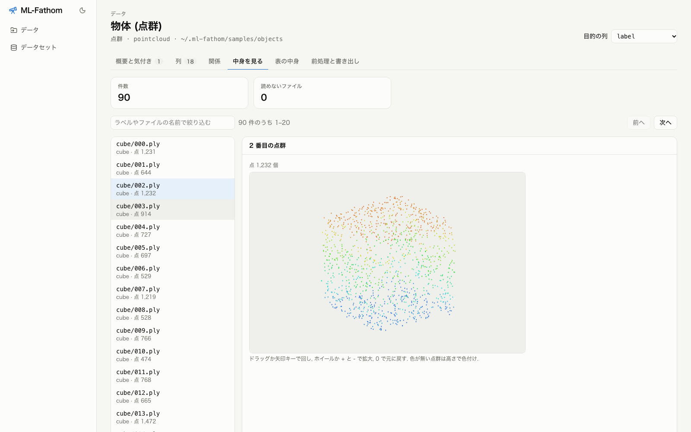

# ML-Fathom 操作ガイド

ML-Fathom の使い方を, データを読み込んでから学習用に書き出すまでの順に説明する. 各章の「やってみる」は, アプリが作る見本のデータで試せる (手元のデータは要らない).

## 目次

0. [準備](#準備)
1. [起動する](#1-起動する)
2. [見本のデータを入れる](#2-見本のデータを入れる)
3. [画面の見方](#3-画面の見方)
4. [表を分析する](#4-表を分析する)
5. [前処理を組み立てて書き出す](#5-前処理を組み立てて書き出す)
6. [時系列を扱う](#6-時系列を扱う)
7. [画像, 文, 点群を扱う](#7-画像-文-点群を扱う)
8. [書き出したデータセットで学習する](#8-書き出したデータセットで学習する)
9. [自分のデータを入れる](#9-自分のデータを入れる)
10. [困ったとき](#10-困ったとき)

画面の図は, 幅 1600 px のブラウザで撮った. 図の中のファイルの場所は, 置き場を既定の `~/.ml-fathom` にした場合の表示にしてある.

## 準備

この手順書でよく使う言葉.

| 言葉 | 意味 |
| --- | --- |
| データ | 分析するファイルかディレクトリ. 登録しても元のファイルは変えない |
| 種類 | ML-Fathom (ML-EDA) が判定したデータの形. 表, 時系列, 画像, 文, 点群 |
| 目的の列 | 予測したい列. 分析に目的の列との関係が加わり, 前処理の分割とタスクに使う. 画像などはクラスのフォルダの名前 (`label`) |
| 気付き | 学習の前に確かめた方がよいこと (ID らしい列, リークの疑い, 偏った分布, 大きさのそろわない画像など). 注意と参考の 2 段階 |
| 手順 | 前処理の 1 つの操作 (列を落とす, 欠損を埋める, 標準化するなど). 並べたものがレシピ |
| 中身の手順 | 画像, 文, 点群の 1 件ずつを, 同じ形の配列にする手順 (大きさをそろえる, 語彙で番号にするなど) |
| データセット | 書き出した学習用のデータ. 分割ごとのデータと, 当てはめた値を含むレシピを持つ. ML-Found の学習スクリプトが `load_dataset` で読む |

「やってみる」の前に, ML-Fathom を README の「導入と起動」の手順で導入しておく (`make setup`).

## 1. 起動する

ML-Fathom はローカルで動く Web アプリ. 端末で起動して, 表示された URL をブラウザで開く.

1. ML-Fathom を clone したディレクトリで `make serve` を実行する. 画面をビルドしてから `http://127.0.0.1:8767` で待ち受ける. 端末は使ったままになるので, 止めるまでそのままにする
2. 端末に `ML-Fathom を開く: http://127.0.0.1:8767/api/auth?token=…` と出るので, その URL を開く. トークンは起動するたびに変わる
3. 「データ」の画面に「まだデータがありません」と出れば準備完了

```bash
make serve
```

> **トークンを毎回同じにする**
> `ML_FATHOM_TOKEN=好きな文字列 make serve` で起動すると, `http://127.0.0.1:8767/api/auth?token=好きな文字列` を開けば入れる.

登録したデータ, レシピ, 書き出したデータセットは置き場 `~/.ml-fathom/` に置く (環境変数 `ML_FATHOM_HOME` で変えられる).



## 2. 見本のデータを入れる

操作を試すための見本を, 種類ごとに 1 つずつ作って登録する. どれも学習の前に直すことを含む.

| 見本 | 種類 | 中身 | 直すこと |
| --- | --- | --- | --- |
| 顧客の解約 | 表 | 1,500 人の契約と利用の様子. 目的の列 `churn` (yes / no) | ID の列, 欠損, 偏った分布, 答えから作った列 (リーク) |
| 電力の使用量 | 時系列 | 90 日分の 1 時間ごとの使用量と気温. 目的の列 `usage_kwh` | 時刻の抜け (センサーの停止), 過去の値の列が要る |
| 図形 | 画像 | 円, 四角, 三角 (各 120 枚) | 大きさが 3 種類, 灰色とカラーの混在, 読めないファイル |
| レビュー | 文 | 良い評価と悪い評価 (各 150 件) | 語の番号の並びにする必要がある |
| 物体 | 点群 | 球, 立方体, 円柱 (各 30 件, PLY) | 点の数が件ごとに違う |

### やってみる 1: 見本を登録する (1 分)

- [ ] 「データ」の画面の右上の「見本のデータを入れる」を押す
- [ ] 数秒で「見本を 5 件登録しました」と出て, 5 つのカードが並ぶことを見る. カードには種類, 場所, 読み込み, 目的の列が出る
- [ ] もう一度押すと「見本は登録済みです」と出る (登録し直さない. 見本のファイルを書き換えていても上書きしない)



見本は置き場の `samples/` に作る. カードのごみ箱で登録を外しても, ファイルは消えない.

## 3. 画面の見方

カードの名前を押すと, データごとの画面が開く.

| 場所 | 中身 |
| --- | --- |
| 上 | 名前, 種類, 読み込み, 場所. 右に目的の列 (変えると分析をやり直す) |
| タブ | 概要と気付き, 列, 関係, 時系列 (時系列だけ), 中身を見る (画像, 文, 点群だけ), 表の中身, 前処理と書き出し. 数字は気付きと列の数 |
| 左の一覧 | データ (登録したデータ) と, データセット (書き出したもの) |

右上の月 (暗い表示では太陽) で明るさを切り替える.

## 4. 表を分析する

顧客の解約の表で, 気付き, 列, 関係を見る.

### やってみる 2: 気付きを読む (3 分)

- [ ] 「顧客の解約 (表)」を開く. 「概要と気付き」に, 行 1,500, 列 10, 欠損したセルの数, 重複した行, メモリが並ぶ
- [ ] 気付きの一覧を上から読む

| 気付き | 意味と次にすること |
| --- | --- |
| 注意 `id_like` (`customer_id`) | 全ての値が異なる ID らしい列. 学習に使うと覚えるだけになるので落とす |
| 注意 `target_leak` (`cancel_reason_code`) | 目的の列とほぼ同じ情報 (関連の強さ 1.00). 解約した人にだけ付く理由のコードで, 予測のときには手に入らないので落とす |
| 注意 `high_missing` (`monthly_fee`) | 欠損が多い. 埋めるか, 列を落とす |
| 参考 `skewed`, `outliers` (`data_gb`) | 分布が大きく偏り, 外れ値が多い. 対数を取る候補 |



**見どころ**: 気付きの列の名前 (灰色の枠) を押すと, その列の詳細 (「列」のタブ) に移る.

### やってみる 3: 列と関係を見る (3 分)

- [ ] 「列」のタブで, 左の一覧から `data_gb` を押す. 型, 件数, 欠損, 平均, 分位点, 歪度, 外れ値の数と, ヒストグラムが出る. 右に大きく伸びた分布であることを見る
- [ ] 一覧の上の欄に `fee` と打つと, 列の名前で絞り込める. 列の名前の横の点は, その列に気付きがある印


- [ ] 「関係」のタブを開く. 左上に目的の列の分布 (no が yes の約 2 倍), 右上に目的の列との関連の強さが並ぶ. `cancel_reason_code` だけが 1 に近く, 他の列 (`contract`, `support_calls` など) は 0.1 から 0.3 程度であることを見る
- [ ] 下の「数値の列の相関」と「カテゴリの列の関連」のヒートマップで, `tenure_months` と `total_paid` の相関 (0.84) のような, 似た情報を持つ列の組を見る. 相関は Spearman (順位) と Pearson (直線) を切り替えられる


「表の中身」のタブでは, 元のデータを並べ替え (列の名前を押す), 絞り込み, ページ送りで見られる.

## 5. 前処理を組み立てて書き出す

気付きをもとに前処理の手順を並べ, 学習用に書き出す.

### やってみる 4: 手順を作る (5 分)

- [ ] 「前処理と書き出し」のタブを開く. 左に目的と分割, 手順, 保存と書き出し. 右に手順をかけた後の表と, 学習用のデータの様子
- [ ] 「気付きから 4 手順を足す」を押す. 気付きに合う手順 (ID とリークの列を落とす, 欠損を埋める, 対数, 外れ値の切り詰め) が足される
- [ ] 続けて「学習できる形にする手順を作る」を押し, 確かめの「OK」を押す. 列の型から, 全ての列を数値にして欠損を無くす手順に置き換わる

| 手順 | 中身 |
| --- | --- |
| 1 `drop_columns` | `customer_id` と `cancel_reason_code` を落とす |
| 2 `impute` | `monthly_fee` を学習用の中央値で埋め, 欠損の印の列 (`monthly_fee_missing`) を足す |
| 3 `impute` | `plan` を最も多い値で埋める |
| 4 `log` | `data_gb` の対数を取る |
| 5 `one_hot` | `plan` と `contract` を 0 と 1 の列にする |
| 6 `standardize` | 数値の列を学習用の平均と標準偏差で標準化する (`auto` で型から選ぶ) |

- [ ] 「分割」を「層化 (クラスの割合を保つ)」にし, 「テスト用の割合」を `0.1` にする. 右の「学習用のデータ」が「分割: train 1,050 行, valid 300 行, test 150 行」「学習に使う列: 12」「クラス: no, yes」になり, 注意が出ないことを見る


**見どころ**: 「学習用で当てはめ」の印が付いた手順 (補完, 標準化, ワンホットなど) は, 分割した後の学習用の行だけで値を学ぶ. 検証用とテスト用の値が前処理に漏れない.

### やってみる 5: 1 つの手順の前と後を見る (2 分)

- [ ] 手順 2 (`impute`) の番号を押す. 右が「手順 2 (impute) の前と後」になり, 前の表の `monthly_fee` の欠損 (–) が, 後の表で中央値 (68.19) になり, 足した列 `monthly_fee_missing` が色付きで出る
- [ ] もう一度番号を押すと, 全ての手順の後に戻る


手順は, 右の矢印で並べ替え, ごみ箱で消し, 欄で引数を変えられる. 下の「足す手順を選ぶ」から 1 つずつ足すこともできる. 引数の説明は欄の下に出る.

### やってみる 6: 保存して書き出す (2 分)

- [ ] 「レシピを保存」を押す (「保存しました」と出る). 保存しないで他のタブに移っても, 作りかけの手順は残る
- [ ] 「データセットの名前」に `churn` と入れて「学習用に書き出す」を押す
- [ ] 「書き出しました: ~/.ml-fathom/datasets/churn」と, ML-Found の学習スクリプトで読み込む例が出る
- [ ] 左の「データセット」を開くと, 書き出したデータセット (種類とタスク, 目的の列, 学習に使う列, 分割, 場所, 作った時刻) が並ぶ





同じ名前で書き出し直すには, 「同じ名前があれば置き換える」に印を付ける.

## 6. 時系列を扱う

時刻の列を持つ表は時系列として読む. 時刻の間隔, 抜け, 周期を見て, 過去の値の列を作る.

### やってみる 7: 周期と抜けを見る (3 分)

- [ ] 「電力の使用量 (時系列)」を開く. 気付きに注意 `irregular_interval` (時刻の間隔の抜け) が出る
- [ ] 「時系列」のタブを開く. 時刻の間隔 1 時間, 抜け 2 か所, 期間 2026-01-01 から 2026-03-31 が並ぶ
- [ ] 系列のグラフで, 使用量 (`usage_kwh`) が 1 日の周期で上下することを見る. ホイールと下のつまみで範囲を変えられる. 右上の印で系列を選ぶ
- [ ] 下の「自己相関 (周期の手がかり)」で, ずらし幅 24 に山があり, 周期の候補 (色の違う棒) になっていることを見る



### やってみる 8: 過去の値の列を作る (3 分)

- [ ] 「前処理と書き出し」を開き, 「タスク」を「予測 (時系列)」, 「分割」を「時刻の順 (最後を検証用に)」にする
- [ ] 「学習できる形にする手順を作る」を押す. 自己相関で見つけた周期 24 から, 3 つの手順ができる

| 手順 | 中身 |
| --- | --- |
| 1 `lag` | 数値の列 (目的の列も) の 1 つ前と 24 個前の値, 24 個の移動平均の列を足す (`usage_kwh_lag1`, `usage_kwh_lag24`, `usage_kwh_mean24` など). どれも過去の値だけを使う |
| 2 `drop_missing` | 過去の値が足りない始めの行を落とす |
| 3 `standardize` | 標準化する |

- [ ] 右の「学習用のデータ」が「分割: train 1,675 行, valid 419 行」「学習に使う列: 7」になることを見る. 検証用は学習用より後の時刻の行


**見どころ**: 目的の列 `usage_kwh` そのものは学習に使う列に入らない (その時刻の答えなので). 時刻の抜けの前後では, 「1 つ前」が 1 時間前とは限らない. 抜けが多いデータでは, 抜けを埋めるか, 抜けの前後を分けて扱う.

## 7. 画像, 文, 点群を扱う

画像, 文, 点群は, ファイルの一覧 (読み込みの表) と, 1 件ずつの中身を分けて扱う. 表の手順で件を絞り, 中身の手順で同じ形の配列にする.

### やってみる 9: 画像を見て配列にする (4 分)

- [ ] 「図形 (画像)」を開く. 気付きに `mixed_sizes` (大きさが 3 種類), `mixed_modes` (RGB と灰色), `unreadable_items` (読めないファイル 1 件) が出る
- [ ] 「中身を見る」のタブで, 件数, 最も多い大きさ, 色の形式, 明るさの平均と, 画像の一覧を見る. 上の欄でラベルやファイルの名前 (`triangle` など) で絞り込める. 読めない画像は「読めません」と出る


- [ ] 「前処理と書き出し」を開き, 「分割」を「層化」にして, 「学習用の配列にする手順を作る」を押す
    - 表の手順に `filter_rows` (`width` が `notna`. 読めない件は大きさが欠損になるので, それを除く) が足される
    - 中身の手順に `resize` (最も多い大きさ), `rgb` (灰色とカラーを 3 チャンネルに), `normalize` (学習用の平均と標準偏差で正規化) ができる
- [ ] 右の「学習用のデータ」が「分割: train 288 行, valid 72 行」「クラス: circle, square, triangle」になり, 注意が出ないことを見る



- [ ] 右の下の「中身の手順の前と後」で「数件で試す」を押す. 学習用から選んだ 8 枚の, 手順の前 (元の画像) と後 (64x48 の 3 チャンネル, 正規化) が並ぶ. 手順を変えたら「もう一度試す」を押す

**見どころ**: 画像などの「前と後」は, 中身を読まずに確かめる (数十万枚でもすぐに出る). 手順を消してみると, 「読めない件が 1 件あります」「画像の大きさがそろっていません」のような, 書き出しで失敗する理由が先に出る. 中身は書き出すときに 1 枚ずつ読み, ファイルに少しずつ書く.

### やってみる 10: 文と点群を見る (3 分)

- [ ] 「レビュー (文)」の「中身を見る」で, 文の一覧 (ラベルと文字数) を見る. 「前処理と書き出し」の「学習用の配列にする手順を作る」で, `vocabulary` (学習用の文で語彙を作り, 決まった長さの番号の並びにする) ができる. 空白で区切らない文 (日本語など) は文字ごとの語彙になる. 「数件で試す」で, 文が語の番号の並び (語彙に無い語は `<unk>`, 長さをそろえる詰め物は `<pad>`) になる様子を見られる



- [ ] 「物体 (点群)」の「中身を見る」で, 左の一覧から 1 つ選ぶ. 右に 3D で描かれる. ドラッグか矢印キーで回し, ホイールか `+` と `-` で拡大, `0` で元に戻す. 色の無い点群は高さで色付けする
- [ ] 「学習用の配列にする手順を作る」で, `sample_points` (点の数の中央値にそろえる) と `normalize_cloud` (中心を原点にし, 最も遠い点までを 1 にする) ができる



## 8. 書き出したデータセットで学習する

書き出したデータセットは, ML-EDA の `load_dataset` で読む. 学習のスクリプトに前処理を書く必要は無い. 書き出した後の画面に出る例と同じ.

```python
from ml_eda import load_dataset
from torch.utils.data import DataLoader, TensorDataset

dataset = load_dataset("~/.ml-fathom/datasets/churn")
train_loader = DataLoader(TensorDataset(*dataset.tensors("train")), batch_size=64, shuffle=True)
valid_loader = DataLoader(TensorDataset(*dataset.tensors("valid")), batch_size=64)
# 入力の形: dataset.info["splits"]["train"]["shape"][1:], 分類のクラスの数: len(dataset.info["classes"])
```

| 使うもの | 中身 |
| --- | --- |
| `dataset.tensors("train")` | 学習に使う列 (画像などは配列) と目的の列の 2 つのテンソル. 分類のクラスは番号 (`dataset.info["classes"]` の順) |
| `dataset.arrays("train")` | 同じものを NumPy の配列で (画像などはファイルから少しずつ読む) |
| `dataset.transform(frame)` | 新しい表に, 書き出したときと同じ前処理をかける (推論用). 学習に使った列が足りなければ誤りになる |
| `dataset.transform_item(item)` | 新しい画像, 文, 点群に, 同じ中身の手順をかける |

学習の環境に ML-EDA を入れる方法は ML-EDA の README を参照. ML_tester のタスク 14 (表) と 15 (画像) が, 書き出したデータセットを ML-Found で学習する例になっている.

## 9. 自分のデータを入れる

### やってみる 11: ファイルを選んで登録する (2 分)

- [ ] 「データ」の画面の「データを追加」を押す
- [ ] 上の欄に場所 (例: `~/data`) を入れて「移動」を押すか, 一覧のディレクトリの「開く」で移る. 「上へ」で 1 つ上, 「ホーム」でホームディレクトリに戻る
- [ ] ファイルを押すか, ディレクトリなら「このディレクトリを選ぶ」を押す. 下に, 形式を判定した読み込みの候補が確からしさの順に出る
- [ ] 読み込みを選んで「追加」を押すと, 登録してデータの画面が開く


| 読めるもの | 例 |
| --- | --- |
| 表 | csv, tsv, txt (区切り文字を判定), json, jsonl, parquet, xlsx, npy (2 次元) |
| 時系列 | 日時の列を持つ表 (時刻の順に並べる) |
| 画像 | クラスごとのフォルダに分けた png, jpg など (フォルダの名前がラベル). 1 つのフォルダに並べた画像 |
| 文 | クラスごとのフォルダに分けた txt. 1 行 1 文の txt |
| 点群 | ply (ASCII とバイナリ), pcd, xyz, pts, npy (N×3 以上). クラスごとのフォルダにも分けられる |

文字コード (UTF-8, Shift_JIS, EUC-JP) と, カンマ付きの数 (`1,210`) は読み込みで判定する.

## 10. 困ったとき

| 症状 | 対処 |
| --- | --- |
| 画面が開かない, 「トークンが違います」 | 端末に出た最新の URL を開く (トークンは起動ごとに変わる) |
| カードに「ファイルがありません」 | 元のファイルが動いたか消えた. 登録を外し, 新しい場所で登録し直す |
| 書き出しで「学習用の行がありません」 | 検証用とテスト用の割合が大きすぎるか, `filter_rows` で行を絞りすぎている |
| 書き出しで「〜を読めません」 | 読めない画像などがある. 表の手順 `filter_rows` で除く (「学習用の配列にする手順を作る」なら自動で足す) |
| 書き出しで「〜は既にあります」 | 名前を変えるか, 「同じ名前があれば置き換える」に印を付ける |
| 右の様子に「〜は数値ではありません」 | 文字の列が残っている. `one_hot`, `label_encode` で符号化するか, 落とす |
| 分析の数が全体と少し違う | 10 万行を超える表は, 無作為に選んだ 10 万行 (時系列は等間隔の 10 万行) で分析する. 書き出しは全ての行を使う |
